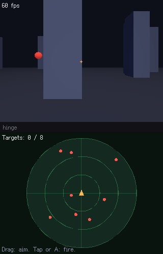
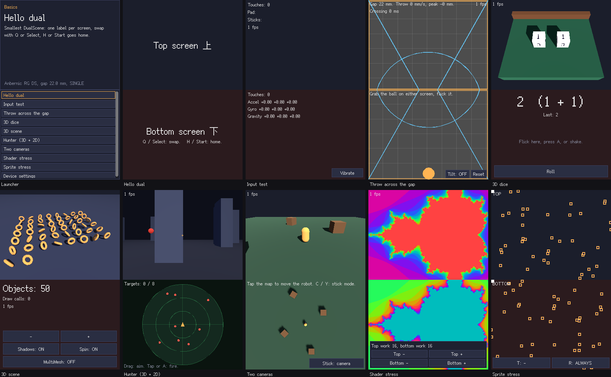

# Dual Screen for Godot 4

A Godot 4.7 addon for games and tools that use **two screens at once**, like a Nintendo DS: one scene, a top screen
and a bottom screen, both touch-enabled.

It runs on:

- **dual-screen Android handhelds**: the top and bottom content go to the two real displays;
- **desktop**: two OS windows;
- **everywhere else** (phones, web, the editor, headless tests): both screens stacked in one window.



*The Hunter example on an Anbernic RG DS: 3D on the top display, 2D touch radar on the bottom one, 60 fps.*

## Status

Early, and used by a handful of small projects.

| Platform | State |
|---|---|
| **Anbernic RG DS** (Android 14, RK3568, two 640x480 touch screens) | Tested: both displays, touch on both, gamepad, about 60 fps in the examples |
| AYN Thor | Device profile only, from the published specs. **Not tested** on the device |
| Other dual-screen Android devices | Should work if Android exposes the second screen as a display; needs a device profile |
| Linux desktop (two windows, or stacked) | Tested |
| Windows, macOS desktop | Not tested |
| Phones, web | Stacked mode; not tested much |

Requires **Godot 4.7** with the **Compatibility** renderer (GLES3). The Android part is a Kotlin plugin, already built
(`android/bin/*.aar`).

If you try it on another device, an issue with the result (and the values for a device profile) is very welcome.

## Examples

The examples live in a separate project, [godot-dual-core](https://github.com/P1tayaa/godot-dual-core): input test,
throwing an object across the hinge, 3D dice, a 3D scene, a 3D + 2D game, two cameras, and shader and sprite stress
tests.



## Install

The repository root **is** the addon folder: put it at `addons/dual_screen` in your project.

As a git submodule (easy to update):

```bash
git submodule add https://github.com/P1tayaa/godot-dual-screen.git addons/dual_screen
```

Or download the repository as a ZIP and unpack it into `addons/dual_screen`.

Then **Project > Project Settings > Plugins > Dual Screen: enable**. Enabling the plugin:

- adds the `Screens` autoload;
- adds three input actions: `swap_screens` (Q / Select), `home` (H / Start), `toggle_mode` (C / Y);
- adds the addon's translations;
- sets what the addon needs, only where your project has no value yet: Compatibility renderer, nearest texture
  filter, mouse emulates touch, sensors on, the default theme.

Set `dual_screen/home_scene` in Project Settings to the scene the `home` action goes back to.

Update the submodule: `git submodule update --remote addons/dual_screen`.

## Your first dual-screen scene

1. **Scene > New Inherited Scene**, pick `res://addons/dual_screen/dual_scene/dual_scene.tscn`.
2. Put the top screen's nodes under `TopContainer/TopViewport`, the bottom screen's under
   `BottomContainer/BottomViewport`. In the editor you see both screens stacked, like the device.
3. Attach a script that extends `DualScene`:

```gdscript
class_name MyScreen
extends DualScene

var _score: int = 0


func _ready() -> void:
	super._ready() # registers the scene with Screens
	# A static screen costs nothing: it only redraws when asked.
	set_redraw(Screen.BOTTOM, Redraw.ON_CHANGE)


func add_point() -> void:
	_score += 1
	%Score.text = str(_score) # a Label under BottomViewport, "Access as Unique Name" on
	request_redraw(Screen.BOTTOM)
```

4. Run it (F6). Change scenes with `Screens.change_scene("res://...tscn")`.

Each screen is a `SubViewport`, so anything works in it: Controls, 2D, 3D, shaders.

## How it works

```
DualScene (VBoxContainer)
├── TopContainer (SubViewportContainer)
│   └── TopViewport (SubViewport)        top screen content
└── BottomContainer (SubViewportContainer)
    └── BottomViewport (SubViewport)     bottom screen content
```

The `Screens` autoload picks a mode at start and decides where the two viewports are shown:

| Mode | When | Shown by |
|---|---|---|
| `SINGLE` | headless, web, phones, game embedded in the editor, `--screens=single` | the scene's own containers, stacked |
| `DESKTOP` | desktop, `--screens=desktop` | the main window (top) and a second OS window (bottom) |
| `ANDROID` | Android with a second display | the app's display and the plugin's display |

Force a mode with the `dual_screen/screen/mode` setting (`auto`, `single`, `desktop`) or the command line:
`godot --path . -- --screens=single`.

### Input

- **Touch** goes to the screen it lands on. Pointer input is **touch only** (`InputEventScreenTouch` /
  `InputEventScreenDrag`); on desktop the mouse emulates touch.
- **Keys and gamepad** go to both screens.
- `swap_screens` swaps the two screens, `home` goes to `dual_screen/home_scene`.

### Redraw modes

Each screen redraws `ALWAYS` (every frame) or `ON_CHANGE` (only after input or `request_redraw()`). Use
`ON_CHANGE` for menus, cards, anything that is still most of the time: on a weak handheld it saves battery and keeps
the other screen smooth. Switch to `ALWAYS` while something animates, back to `ON_CHANGE` after.

### Pixel scale

The base size of each screen comes from the device profile (320x240 on the RG DS, shown at 2x). `pixel_scale` on a
`DualScene` renders at a higher multiple (sharper text and 3D) while the scene keeps its base coordinates.

## The real gap between the screens

`use_physical_world_2d()` puts both screens into **one 2D world measured in millimetres**, each viewport looking
through a camera placed where its panel really is, hinge gap included. An object thrown off the top of the bottom
screen disappears into the hinge for the time it really takes to cross it, then shows up on the top screen.

```gdscript
func _ready() -> void:
	super._ready()
	use_physical_world_2d()


func _on_touch(event: InputEventScreenTouch) -> void:
	var world_mm: Vector2 = screen_to_world(Screen.BOTTOM, event.position)
```

For a lighter version (an object handed from one screen to the other), compute the crossing time yourself:

```gdscript
var px_per_mm: float = Screens.profile.spec(Screen.BOTTOM).px_per_mm()
var gap_time: float = Screens.profile.gap_mm / (speed_px_per_s / px_per_mm)
```

## Device profiles

A `DeviceProfile` (`profiles/devices/*.tres`) describes a device:

| Field | What |
|---|---|
| `top`, `bottom` (`ScreenSpec`) | panel resolution, visible size in mm, game base size |
| `gap_mm` | from the lower edge of the top screen to the upper edge of the bottom one, device opened flat |
| `offset_mm` | horizontal shift of the top screen's centre |
| `main_display_is_top` | Android: is the display the app starts on the top screen |
| `model_names` | values of `OS.get_model_name()` that select this profile |

The profile is chosen in this order: the one saved by the settings screen (`user://dual_screen.cfg`), else a model
name match, else `dual_screen/default_profile`.

`settings/device_settings.tscn` is a ready-made screen to switch profiles and fine-tune the gap and offset on the
device (diagonal lines must line up across the hinge).

**Add a device:** copy `profiles/devices/rg_ds.tres`, fill in both screens, the gap and the model name, then calibrate
on the device in the settings screen.

## Android

- Export with **Gradle builds** on (`gradle_build/use_gradle_build=true`) and the Android build template installed
  (Project > Install Android Build Template). The addon adds its AAR to the export.
- The bottom screen is drawn on the second display by the plugin. Two ways, set with `dual_screen/android/transport`:
  - `gl` (fast): draws Godot's viewport texture directly, sharing Godot's GL context. Recommended.
  - `readback`: copies the image through the CPU every frame. Slower, kept as a fallback.
- The second display does not take focus, so the gamepad keeps working in the game.

Rebuild the plugin after changing the Kotlin code in `android/plugin_src/` (ignored by Godot):

```bash
cd android/plugin_src && JAVA_HOME=/usr/lib/jvm/java-21-openjdk ./gradlew copyToAddon
```

## Tests and tools

- A small headless test runner: `godot --headless --path . --script res://addons/dual_screen/testing/run_tests.gd`
  runs every `res://tests/test_*.gd`. Test files extend `TestCase` (`eq`, `ok`, `add_scene`, `frames`,
  `physics_frames`, `press(action)`); a test fails on any engine error logged while it runs.
- `tools/screenshot.gd` renders a scene in the stacked layout to a PNG.
- `ui/fps_label.gd`: an FPS label per screen.

## Known limits

- **Only tested on the Anbernic RG DS.** Other devices need a profile and may need fixes.
- Pointer input is touch only. Hover does not exist on a viewport shown outside its container.
- A `SubViewportContainer` that is hidden stops its viewport; `Screens` handles this for the built-in modes.
- MSDF fonts inside a nearest-filtered viewport need `texture_filter = LINEAR` on the node that draws them.
- Compatibility renderer only.

## Files

| Path | What |
|---|---|
| `screens.gd` | `Screens` autoload (`ScreensService`): mode, device profile, swap, home, input routing |
| `dual_scene/` | `DualScene`, the base scene |
| `surfaces/` | `ScreenPresenter` (window surfaces), `AndroidDisplay` (second display) |
| `physical/` | `WorldGrid`: millimetre grid and screen outlines for the physical world |
| `profiles/` | `DeviceProfile`, `ScreenSpec`, device presets |
| `settings/` | device settings and calibration screen |
| `testing/` | headless test runner and `TestCase` |
| `theme/` | default theme, Fusion Pixel 12 px font (covers Latin and Chinese) |
| `android/` | export plugin, built AARs, Kotlin source |
| `docs/` | `PHILOSOPHY.md` and `CONVENTIONS.md`: how projects on this addon are written |

## Licence

Code: MIT, see `LICENSE`. The Fusion Pixel font in `theme/fonts/` is under the SIL Open Font License (its licence
files are next to it).

## TODO

- Test on an AYN Thor and fix its profile.
- Measure the RG DS hinge gap precisely (22 mm is an estimate).
- Try Windows and macOS desktop mode.
